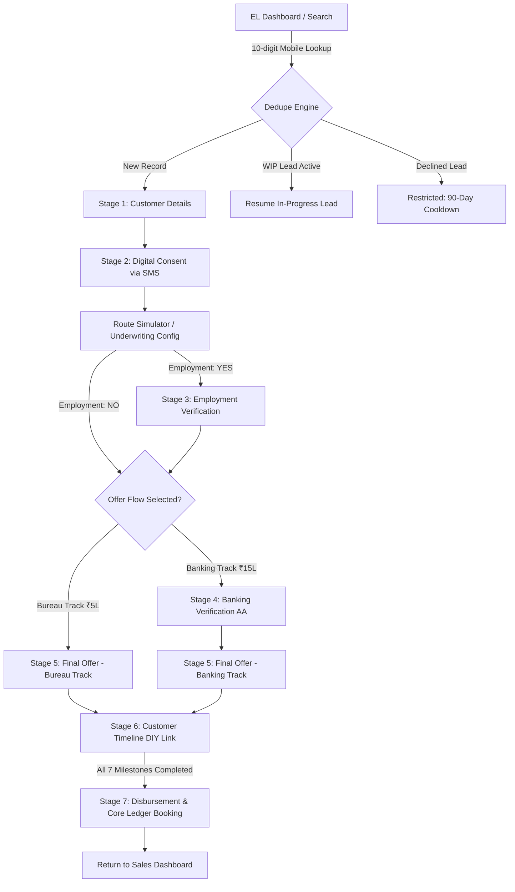

# Product Requirement Document (PRD)
## Pulse Assisted Education Loan (EL) Portal

- **Document Version:** 1.0.0
- **Module:** Domestic Agent-Assisted Education Loan Origination, Underwriting & Disbursement
- **Target Audience:** Direct Sales Agents (DSAs), Branch Relationship Managers (RMs), Credit Officers, Engineering Teams
- **Status:** Approved / Production Specification
- **Scope:** End-to-End EL Journey (Dedupe & Lead Search, Customer Details & KYC, Digital Regulatory Consent, Underwriting Route Simulator, Multi-Modal Employment Verification, Account Aggregator Banking Verification, Final Offer Sanctions, Customer DIY Onboarding Timeline, and Core Ledger Disbursement).

---

## 1. Executive Summary & Product Vision

### 1.1 Objective
Empower field agents and branch officers to assist domestic student applicants in securing higher education loans (undergraduate, postgraduate, doctoral, and professional programs) with zero physical paperwork. The application features instant deduplication, Aadhaar/CIBIL consent, dual-track underwriting (Bureau-based express track vs. Account Aggregator banking track), multi-modal employment verification (payslip, EPFO UAN, work email), transparent pricing without deductions from disbursal, and instant core banking ledger disbursement.

### 1.2 Core Value Propositions
1. **Instant Deduplication & Status Routing:** Real-time lookup on 10-digit mobile number prevents duplicate leads, allows resuming in-progress applications, and enforces a 90-day cooldown period on declined files.
2. **Flexible Route Simulation (BRE Engine):** Allows sales agents and underwriters to switch between:
   - **Bureau-Sanction Track (₹5,00,000 cap):** Express path skipping banking verification.
   - **Banking-Sanction Track (₹15,00,000 enhanced sanction):** In-depth Account Aggregator (AA) statement analysis.
3. **Multi-Modal Employment Validation:** Option to verify salaried co-borrowers/applicants via:
   - Salary Slip Upload (with password protection & PDF preview)
   - EPFO UAN Automated API Verification
   - Official Corporate Email OTP Authentication
4. **Transparent Customer DIY Onboarding:** Digital disbursement checklist tracking (Penny drop, eNACH, KFS, and eSign) with instant RTGS/NEFT ledger confirmation.

---

## 2. End-to-End Workflow Architecture



---

## 3. Comprehensive Data Dictionary & Field Specifications

### 3.1 Stage 0: Customer Lookup & Dedupe Engine
| Field Name | Data Type | Mandatory | Allowed Values / Format | Default Value | Validation & Business Logic |
| :--- | :--- | :---: | :--- | :--- | :--- |
| `mobileQuery` | `string` | Yes | 10 numeric digits (`^[6-9]\d{9}$`) | `""` | Strips non-digits; must be exactly 10 digits before triggering status lookup. |
| `searchInitiated` | `boolean` | System | `true` \| `false` | `false` | Set to `true` when search button is clicked; resets when mobile changes. |
| `selectedCase` | `string \| null` | System | `"new"` \| `"wip"` \| `"rejected"` \| `null` | `null` | Result of dedupe check against mock database (`MOCK_EXISTING_EL_LEADS`). |

#### Dedupe Lookup Table (`MOCK_EXISTING_EL_LEADS`)
```typescript
interface ExistingLead {
  id: string;               // e.g., "LEAD-EL-10492"
  appId: string;            // e.g., "EL-84920"
  name: string;             // e.g., "Rohan Kulkarni"
  maskedName: string;       // e.g., "Roh** Kulka***"
  mobile: string;           // e.g., "9876543210"
  maskedMobile: string;     // e.g., "98****3210"
  pan: string;              // e.g., "BKUPK7890L"
  maskedPan: string;        // e.g., "BK***7890L"
  course: string;           // e.g., "MBA in International Business"
  institution: string;      // e.g., "IIM Ahmedabad"
  requestedAmount: number;  // e.g., 2200000 (INR)
  stageId: number;          // 2 = Consent, 3 = Employment, 4 = Banking/Offer, 7 = Timeline
  stageName: string;        // "Consent Pending" | "Employment Verify" | "Customer Timeline"
  status: string;           // "Offer Ready" | "Awaiting Consent" | "Verification In Progress"
  createdAt: string;        // ISO 8601 Date String (e.g., "2024-10-15T10:30:00Z")
}
```

---

### 3.2 Stage 1: Customer Details (`Stage3BasicDetails`)

#### A. Personal & Identity Information
| Field Name | Data Type | Mandatory | Allowed Values / Format | Sample Value | Validation & Constraints |
| :--- | :--- | :---: | :--- | :--- | :--- |
| `fullName` | `string` | Yes | Alphabetic with spaces, 3 to 100 chars | `"Aarav Sharma"` | Trimmed; required; must match identity proof (PAN/Aadhaar). |
| `fatherName` | `string` | Yes | Alphabetic with spaces, 3 to 100 chars | `"Ramesh Sharma"` | Trimmed; required. |
| `gender` | `string` | Yes | `"Male"` \| `"Female"` \| `"Other"` | `"Male"` | Dropdown selection; cannot be empty. |
| `maritalStatus` | `string` | Yes | `"Single"` \| `"Married"` \| `"Divorced"` \| `"Widowed"` | `"Single"` | Dropdown selection; cannot be empty. |
| `pan` | `string` | Yes | 10 chars uppercase alphanumeric regex: `^[A-Z]{5}[0-9]{4}[A-Z]{1}$` | `"ABCPS1234F"` | Auto-capitalized on typing. 4th character must be `'P'` for individual applicant. |
| `dob` | `string` | Yes | `YYYY-MM-DD` | `"2001-05-14"` | Derived from date picker. **Rule:** Age must be $\ge 18$ years: `differenceInYears(new Date(), dob) >= 18`. Under 18 raises error: `"Customer must be at least 18 years old to apply."` |
| `email` | `string` | Yes | Valid email format (`^[^\s@]+@[^\s@]+\.[^\s@]+$`) | `"aarav.sharma@example.com"` | Trimmed; required; must contain `@` and valid domain. |

#### B. Address & Location Information
| Field Name | Data Type | Mandatory | Allowed Values / Format | Sample Value | Validation & Constraints |
| :--- | :--- | :---: | :--- | :--- | :--- |
| `address` | `string` | Yes | Alphanumeric, min 10 chars | `"Flat 402, Green Glen Apartments, Bellandur"` | Trimmed; mandatory residential address. |
| `landmark` | `string` | No | Alphanumeric | `"Near Central Mall"` | Optional nearby landmark. |
| `pinCode` | `string` | Yes | 6 numeric digits (`^\d{6}$`) | `"560001"` | On typing 6 digits, queries `PIN_LOCATION_MAP`. |
| `city` | `string` | Read-only | Auto-populated city name | `"Bengaluru"` | Non-editable input; populated from PIN lookup. |
| `state` | `string` | Read-only | Auto-populated state name | `"Karnataka"` | Non-editable input; populated from PIN lookup. |
| `pinIsServiceable`| `boolean` | System | `true` \| `false` | `true` | If `PIN_LOCATION_MAP[pin].serviceable === false` (e.g. `999999`), blocks submission: *"Selected PIN code is unserviceable."* |

#### C. Education, Employment & Loan Parameters
| Field Name | Data Type | Mandatory | Allowed Values / Options | Sample Value | Validation & Constraints |
| :--- | :--- | :---: | :--- | :--- | :--- |
| `courseName` | `string` | Yes | 10 approved programs (see Course Catalog below) | `"MS in Data Science & Artificial Intelligence"` | Dropdown selection from approved programs. |
| `institutionName`| `string` | Optional | 10 approved institutes (see Institution Catalog) | `"Indian Institute of Science (IISc)"` | Academic institute name. |
| `admissionStatus`| `string` | Optional | `"Confirmed Admission"` \| `"Conditional Offer"` \| `"Applied / Awaiting Merit List"` | `"Confirmed Admission"` | Admission confirmation status. |
| `highestEducation`| `string` | Yes | 6 predefined education levels (see Education Levels below) | `"Graduate / Bachelor's Degree"` | Mandatory qualification dropdown. |
| `employerName` | `string` | Yes | Alphanumeric, min 2 chars | `"Tata Consultancy Services Ltd"` | Mandatory company/organization name. |
| `salary` | `number` | Yes | Numeric integer (INR) | `85000` | Minimum value: ₹10,000 / month. Error if `< 10000`. |
| `loanAmount` | `number` | Yes | Numeric integer: `100000` to `4999999` | `2500000` | Range: ₹1,00,000 to ₹49,99,999. Formatted with Indian commas. |
| `loanTenure` | `number` | Yes | `24` \| `36` \| `48` \| `60` \| `72` \| `84` \| `96` \| `120` | `84` | Tenure in months (2 to 10 years). |
| `employmentType` | `string` | Yes | `"Salaried"` \| `"Self-employed"` | `"Salaried"` | **Hard Policy Blocker:** If `"Self-employed"`, display red alert banner and disable `Save & Proceed` CTA. Online flow is restricted to Salaried only. |

#### Predefined Master Catalogs
- **10 Approved Courses (`MOCK_COURSES`):**
  1. `"B.Tech in Computer Science & Engineering"`
  2. `"MBA in International Business & Finance"`
  3. `"MS in Data Science & Artificial Intelligence"`
  4. `"MBBS (Bachelor of Medicine & Surgery)"`
  5. `"M.Des in Interaction & UI/UX Design"`
  6. `"B.Sc in Biotechnology & Bioinformatics"`
  7. `"M.Tech in Robotics & Automation"`
  8. `"Master of Architecture (M.Arch)"`
  9. `"LL.M in Corporate & Cyber Law"`
  10. `"B.Com (Hons) in Fintech & Analytics"`

- **6 Education Levels (`MOCK_EDUCATION_LEVELS`):**
  1. `"High School (10th / 12th)"`
  2. `"Diploma"`
  3. `"Graduate / Bachelor's Degree"`
  4. `"Post Graduate / Master's Degree"`
  5. `"Doctorate / Ph.D."`
  6. `"Professional Degree (CA / CS / ICWA / MBBS)"`

- **PIN Code Location Master (`PIN_LOCATION_MAP`):**
  - `"400051"`: `{ city: "Mumbai", state: "Maharashtra", serviceable: true }`
  - `"400001"`: `{ city: "Mumbai", state: "Maharashtra", serviceable: true }`
  - `"110001"`: `{ city: "New Delhi", state: "Delhi", serviceable: true }`
  - `"560001"`: `{ city: "Bengaluru", state: "Karnataka", serviceable: true }`
  - `"600001"`: `{ city: "Chennai", state: "Tamil Nadu", serviceable: true }`
  - `"500001"`: `{ city: "Hyderabad", state: "Telangana", serviceable: true }`
  - `"700001"`: `{ city: "Kolkata", state: "West Bengal", serviceable: true }`
  - `"411001"`: `{ city: "Pune", state: "Maharashtra", serviceable: true }`
  - `"380001"`: `{ city: "Ahmedabad", state: "Gujarat", serviceable: true }`
  - `"302001"`: `{ city: "Jaipur", state: "Rajasthan", serviceable: true }`
  - `"999999"`: `{ city: "Remote Sector", state: "Unassigned", serviceable: false }`

---

### 3.3 Stage 2: Digital Consent (`Stage4Consent`)
| Field Name | Data Type | Mandatory | Allowed Values | Default Value | Description / Trigger |
| :--- | :--- | :---: | :--- | :--- | :--- |
| `consentStatus` | `string` | System | `"idle"` \| `"sending"` \| `"waiting"` \| `"approved"` \| `"rejected"` | `"idle"` | Finite state machine controlling UI state. |
| `timeLeft` | `number` | System | Integer: `0` to `30` | `30` | Decrements by 1 every 1000ms while in `"waiting"` state. |
| `customerMobile`| `string` | Yes | 10 digits | `"9820012345"` | Target phone for SMS dispatch. |
| `action` (UAT) | `string` | System | `"approve"` \| `"reject"` | — | Triggered by test simulator buttons. `"approve"` advances to Simulator after 1200ms. |

---

### 3.4 Intermediate Route Simulator (`StageSimulationScreen`)
| Field Name | Data Type | Mandatory | Allowed Values | Default Value | Behavioral Impact on Workflow |
| :--- | :--- | :---: | :--- | :--- | :--- |
| `offerFlow` | `string` | Yes | `"bureau"` \| `"banking"` | `"bureau"` | `"bureau"` = Sanction cap ₹5L, skips Bank Verify.<br/>`"banking"` = Sanction cap ₹15L, mandates Bank Verify. |
| `employmentRequired` | `boolean` | Yes | `true` \| `false` | `true` | `true` = Enforces Stage 3 Employment Verification.<br/>`false` = Skips Stage 3 directly to Offer/Banking. |

---

### 3.5 Stage 3: Employment Verification (`Stage5EmploymentVerification`)

#### Decision & Tab Navigation
| Field Name | Data Type | Allowed Values | Default Value | Description |
| :--- | :--- | :--- | :--- | :--- |
| `decision` | `string` | `"unselected"` \| `"yes"` \| `"no"` | `"unselected"` | `"yes"` enters verification; `"no"` calls `onSkip()`. |
| `activeTab` | `string` | `"salary_slip"` \| `"uan"` \| `"email_otp"` | `"salary_slip"` | Controls which verification method is active. |

#### Method A: Salary Slip Upload Fields
| Field Name | Data Type | Allowed Values / Structure | Description |
| :--- | :--- | :--- | :--- |
| `uploadState` | `string` | `"idle"` \| `"uploading"` \| `"uploaded"` | Tracks upload lifecycle. |
| `uploadProgress` | `number` | `0` to `100` | Simulates progress (20% $\rightarrow$ 55% $\rightarrow$ 85% $\rightarrow$ 100%). |
| `uploadedDocs` | `Array<Doc>` | `[{ id, name, type: "PDF" \| "PNG Image", size, uploadDate, status: "Uploaded" }]` | Uploaded payslips (e.g., `Salary_Slip_September_2024.pdf`, size 1.4 MB). |
| `previewDoc` | `Doc \| null` | `Doc` object or `null` | Document opened in the preview modal. |

#### Method B: EPFO UAN Verification Fields
| Field Name | Data Type | Allowed Values / Format | Description |
| :--- | :--- | :--- | :--- |
| `uanInput` | `string` | Exactly 12 numeric digits (`^\d{12}$`) | UAN number input. Demo fill sets `"101234567890"`. |
| `uanState` | `string` | `"idle"` \| `"verifying"` \| `"verified"` | Verification lifecycle state. |
| `uanError` | `string \| null` | Error string or `null` | Displayed if input is not 12 digits. |
| `uanDetails.maskedUan` | `string` | e.g., `"1012 •••• 7890"` | Masked UAN format. |
| `uanDetails.employerName`| `string` | e.g., `"Tata Consultancy Services Ltd"` | Organization returned by EPFO API. |
| `uanDetails.memberId` | `string` | e.g., `"MH/BAN/0012345/000/0006789"` | EPFO Member ID string. |
| `uanDetails.doj` | `string` | e.g., `"15-Jul-2021"` | Date of Joining EPFO record. |
| `uanDetails.timestamp` | `string` | e.g., `"21-Oct-2024, 07:45 PM"` | Audit timestamp. |

#### Method C: Official Work Email OTP Fields
| Field Name | Data Type | Allowed Values / Format | Description |
| :--- | :--- | :--- | :--- |
| `officialEmail` | `string` | Valid corporate email (`^[^\s@]+@[^\s@]+\.[^\s@]+$`) | Default derived from company: `aarav.sharma@tcs.com`. |
| `emailState` | `string` | `"idle"` \| `"request_sent"` \| `"checking"` \| `"verified"` \| `"failed"` | Lifecycle of email validation. |
| `simulatedDiyOutcome` | `string` | `"success"` \| `"failure"` | Test simulator toggle. |
| `isEditableAfterVerification` | `boolean` | `true` \| `false` | When `true`, unlocks inline editing of `editedCustomerName` and `editedMobile`. |

---

### 3.6 Stage 4: Banking Verification (`Stage7BankingVerification`)
| Field Name | Data Type | Allowed Values / Range | Default Value | Description |
| :--- | :--- | :--- | :--- | :--- |
| `phase` | `string` | `"idle"` \| `"link_sent"` \| `"self_waiting"` \| `"waiting"` \| `"error"` \| `"rejected"` \| `"success"` | `"idle"` | Finite state machine for AA process. |
| `waitSeconds` | `number` | `10` down to `0` | `10` | 10-second processing countdown. |
| `waitDone` | `boolean` | `true` \| `false` | `false` | Becomes `true` when `waitSeconds === 0`. |
| `errorCode` | `string` | `"ERR_AA_FETCH_TIMEOUT"` | — | Timeout diagnostic on fetch failure. |
| Failure Diagnostic Metrics | Static Display | Inward balance $< ₹35,000$<br/>Bounces $> 2$ in 90 days<br/>FOIR $> 60\%$ | — | Hard decline criteria shown in `"rejected"` phase. |

---

### 3.7 Stage 5: Final Loan Offer Parameters & Financial Formulas

#### Exact Financial Parameter Comparison
| Field / Parameter Name | Data Type | Bureau Track (`Stage6InitialOffer`) | Banking Track (`Stage8FinalOffer`) | Exact Mathematical Formula |
| :--- | :--- | :--- | :--- | :--- |
| `loanAmount` | `number` | **`500000`** (₹5,00,000) | **`1500000`** (₹15,00,000) | Baseline Sanction Principal ($P$) |
| `tenureMonths` | `number` | **`24`** Months (2.0 Years) | **`60`** Months (5.0 Years) | Number of installments ($N$) |
| `interestRate` | `number` | **`10.5`** % p.a. (Fixed) | **`9.25`** % p.a. (Prime Discounted) | Annual Interest Rate ($R$) |
| `monthlyRate` | `number` | `0.00875` ($10.5 / 12 / 100$) | `0.0077083` ($9.25 / 12 / 100$) | $r = R / (12 \times 100)$ |
| `currentEmi` | `number` | **`23188`** (₹23,188 / mo) | **`31326`** (₹31,326 / mo) | $\text{EMI} = \text{round}\left( \frac{P \times r \times (1+r)^N}{(1+r)^N - 1} \right)$ |
| `processingFeeIncGst` | `number` | **`5900`** (₹5,900) | **`17700`** (₹17,700) | $\text{round}(P \times 0.01 \times 1.18)$ (1% Fee + 18% GST) |
| `stampDuty` | `number` | **`50`** (Statutory ₹50) | **`50`** (Statutory ₹50) | Statutory e-Stamp duty charge |
| `totalCharges` | `number` | **`5950`** (₹5,950) | **`17750`** (₹17,750) | $\text{processingFeeIncGst} + \text{stampDuty}$ |
| `netDisbursement` | `number` | **`500000`** (₹5,00,000) | **`1500000`** (₹15,00,000) | **Strict Rule:** $\text{netDisbursement} = P$ (No fee deduction from disbursal) |
| `totalAmount` | `number` | **`505950`** (₹5,05,950) | **`1517750`** (₹15,17,750) | $P + \text{totalCharges}$ |
| `sanctionRef` | `string` | `"PRE-SANCT-{appId}-B1"` | `"SANCT-{appId}-RT2"` | Sanction authorization code |

---

### 3.8 Stage 6: Customer Timeline Milestones (`Stage9CustomerTimeline`)
| Field Name | Data Type | Mandatory | Default Value | Description |
| :--- | :--- | :---: | :--- | :--- |
| `linkSent` | `boolean` | System | `false` | Becomes `true` when "Send Final Offer Link" is clicked. |
| `completed` | `Set<string>` | System | `new Set()` | Set containing IDs of completed milestones. |
| `allDone` | `boolean` | Derived | `false` | True when all 7 step IDs exist in `completed`. |

#### 7 Milestone Steps Specification
| Step ID (`id`) | Step Label (`label`) | Milestone Description (`desc`) | Icon Component |
| :--- | :--- | :--- | :--- |
| `"kyc"` | `"KYC"` | `"Digital KYC and identity verification completed by customer"` | `ShieldCheck` |
| `"offer"` | `"Final Offer"` | `"Customer reviews and accepts the final loan offer terms"` | `IndianRupee` |
| `"kfs"` | `"KFS"` | `"Key Fact Statement signed by customer"` | `FileText` |
| `"pennydrop"` | `"Penny Drop Verification"` | `"₹1 test credit to verify bank account"` | `CreditCard` |
| `"enach"` | `"eNACH"` | `"Electronic NACH mandate registered for EMI deduction"` | `Fingerprint` |
| `"email_verify"` | `"Personal Email ID Verification"`| `"Verification OTP and link authenticated via personal email ID"` | `MailCheck` |
| `"esign"` | `"eSign"` | `"Digital signature on loan agreement"` | `PenLine` |

---

### 3.9 Stage 7: Disbursement & Core Ledger (`Stage10Disbursement`)
| Field Name | Data Type | Allowed Format / Pattern | Sample Value | Description |
| :--- | :--- | :--- | :--- | :--- |
| `countdown` | `number` | `10` down to `0` | `10` | 10-second ledger processing timer. |
| `disbursed` | `boolean` | `true` \| `false` | `false` | Set to `true` when countdown reaches 0. Fires full-screen confetti. |
| `loanAccountNumber` | `string` | Regex: `^PFL-EL-2024-\d{5}$` | `"PFL-EL-2024-84920"` | Unique Loan Account Number (LAN). |
| `utrNumber` | `string` | Regex: `^UTR-SBIN-2024-\d{6}$` | `"UTR-SBIN-2024-583921"` | RTGS/NEFT payment transaction reference with copy button. |
| `netAmount` | `number` | ₹5,00,000 or ₹15,00,000 | `1500000` | Net disbursed amount. |
| `firstEmiDate` | `string` | Date format | `"05 Dec 2026"` | First EMI date factoring in post-course moratorium. |
| `autoDebitBank` | `string` | String | `"SBI (A/C **4821)"` | Active eNACH mandate destination. |

---

## 4. Non-Functional & UI/UX Standards
- **Color Palette:**
  - Primary: `#004499` (Deep Blue), Hover: `#003377`
  - Accents: `#059669` / `#10b981` (Emerald Green), `#d97706` (Amber), `#64748b` (Slate)
  - Surface: White `bg-white`, Neutral `bg-[#F4F6F9]`, Slate `bg-slate-50`
- **Typography:** Modern sans-serif system font stack with tabular font-mono numbers for financial amounts and dates.
- **Responsiveness:** Dynamic 2-column grids on desktop (`grid-cols-1 lg:grid-cols-2`), single-column on mobile/tablet.
- **Micro-Interactions:** Smooth CSS animations (`animate-in fade-in slide-in-from-bottom-4`), active state pulse pings, and celebration confetti on milestones.
